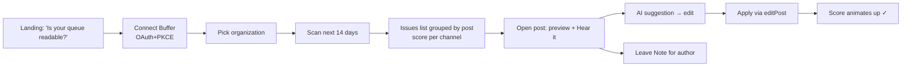
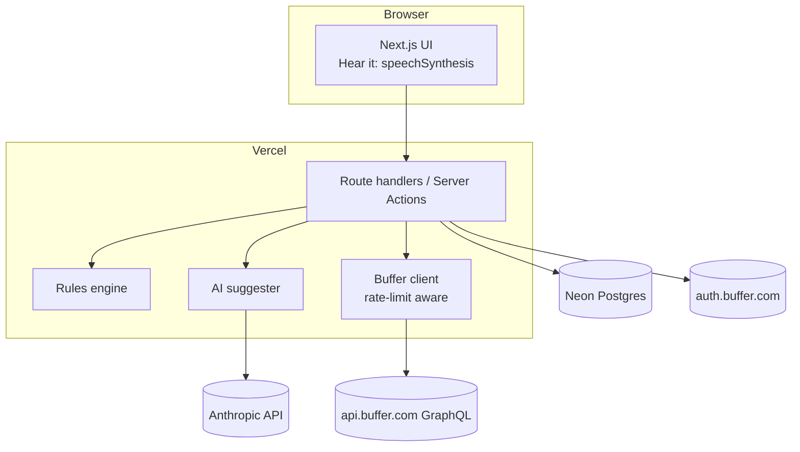

# 01 — Legible

**An accessibility check for your Buffer queue. It finds missing alt text, unreadable "fancy" Unicode, all-lowercase hashtags and emoji walls before they publish, then lets you hear the post the way a screen-reader user will.**

Surface: **standalone Next.js web app**, plus Buffer Notes so its findings show up inside Buffer itself. User: **social managers at nonprofits, universities, public sector teams and accessibility-minded brands**, plus any daily poster who wants inclusive posts.

---

## 1. Problem & target user

| Evidence | Source |
|---|---|
| Buffer stores per-image alt text (`ImageMetadata.altText`), but nothing audits whether a queue actually has it | [reference](https://developers.buffer.com/reference.html) |
| Unicode bold and italic (U+1D400–U+1D7FF) "commonly used for LinkedIn formatting" count double against limits, and screen readers can't read them | [character limits](https://developers.buffer.com/guides/character-limits.html), [suggestion: LinkedIn Unicode handling](https://suggestions.buffer.com/p/document-linkedin-character-limit-and-unicode-handling-in-buffer-docs) |
| Per-platform edge cases are where integrations spend their effort | [Hiding Elephant](https://buffer.com/resources/hiding-elephant-case-study) |
| None of the case studies, listed integrations or MCP features cover accessibility QA | [research §5](../../research/buffer-commit-research.md#5-what-already-exists-dont-duplicate) |
| ASSUMPTION (not cited here): legal pressure is rising, e.g. the EU Accessibility Act (in force June 2025) and US public-sector ADA web rules. Verify the details before you quote them in the write-up | — |

**Primary user:** a comms manager who schedules 10–40 posts a week across 3–6 channels and has an accessibility policy but no time to enforce it.

## 2. Why it wins

| Criterion | Angle |
|---|---|
| Usefulness | Every image post benefits. It fixes problems *before* they publish, in one click, and teammates see the warnings inside Buffer through Notes |
| Craft | A deterministic, unit-tested rules engine, network-accurate UTF-16 counting, safe `editPost` that preserves the schedule, a rate-limit budget meter, keyboard-first and WCAG-AA UI. The tool itself has to be accessible |
| Creativity | Uses Buffer as a *quality gate* rather than another composer. Nothing in the ecosystem does this |
| **Delight** | **"Hear it" toggle:** plays the post through `speechSynthesis` the way a screen reader reads it ("rocket rocket rocket… mathematical bold capital H…"), then the fixed version. A big "aha" moment in the demo. Also a per-channel *Legibility score* that animates up as you fix things |

## 3. MVP vs stretch

| MVP (ship by Nov 12) | Stretch (only if ahead) |
|---|---|
| Buffer OAuth, then pick an organization | Daily background guard (cron) that scans only new posts (`createdAt` checkpoint) |
| Scan: scheduled, draft and needs-approval posts in the next 14 days | Weekly email digest (Resend) |
| 6 rules: missing alt, weak alt ("IMG_123", "image", fewer than 10 chars), fancy Unicode, lowercase multi-word hashtags, emoji runs/density, ALL-CAPS runs | Org rules: brand hashtags, banned phrases |
| AI fix suggestions: alt text from the image (vision), plain-text rewrite, CamelCase hashtags | Shareable "accessibility report" page (public read-only link) |
| Review → edit → **Apply** (`editPost`), with the schedule preserved | Bulk "fix all alt text" with per-item confirm |
| "Leave a Buffer Note" on a flagged post for the author | Mastodon/Bluesky-specific checks (content warnings) |
| "Hear it" before/after, plus Legibility score | |
| Rate-limit budget meter, disconnect and delete data | |

## 4. User flow

## 5. Buffer API usage

| Operation | Scope | Why | Calls |
|---|---|---|---|
| `account { id timezone organizations { id name } }` | account:read | Identify the user and orgs | 1 per login (cached) |
| `channels(input:{organizationId})` → `id name service avatar timezone` | account:read | Labels, service-specific rules | 1 per 30 min (cached) |
| `posts(first:50, input:{organizationId, filter:{status:[scheduled,draft,needs_approval], dueAt:{start,end}}})` → `id text channelId channelService dueAt assets{… on ImageAsset{id source thumbnail image{altText}}}` | posts:read | The scan | 1–3 per scan |
| `editPost(input:{id, text?, assets?})`, with `mode` omitted so the schedule is kept | posts:write | Apply a fix | 1 per fix |
| `createCollaborationNote(input:{subject:{postId}, text})` ⚠️ experimental | notes:write | Flag the issue to the author inside Buffer | 1 per note |

**Scopes requested:** `account:read posts:read posts:write notes:write offline_access`. If Notes breaks, drop `notes:write`; the app still works without it.

**Rate-limit plan:** ~3 calls per scan and ~1 per fix. Assuming the handbook's 250/day per client, that's ~50 scans plus ~100 fixes a day across all users.
- 10-min scan cooldown per org.
- Results are cached in Postgres.
- The budget meter reads the `RateLimit` headers.
- A `429` shows the "breather" state ([shared](../SHARED-FOUNDATION.md#3-buffer-graphql-client)).
- Email `developersupport@buffer.com` early to ask for headroom during judging.

**Assumptions to verify on Day 1 (with `saveToDraft` test posts):**
- `editPost` with a rebuilt `assets` list (same `url` plus `metadata.altText`) keeps the images and the schedule.
- Alt text reaches each network. Some may ignore it, so show "supported on X/Bluesky/LinkedIn…" only for networks confirmed in testing.

## 6. Tech stack

| Layer | Choice | Why |
|---|---|---|
| App | Next.js 15 + TS on Vercel | See [shared](../SHARED-FOUNDATION.md#4-standard-stack-web-ideas) |
| Rules engine | Pure TS module (`/lib/rules`) + `emoji-regex` + `unicode-emoji-json` | Deterministic and testable. Emoji names drive "Hear it" |
| Screen-reader preview | Web Speech API `speechSynthesis` plus a "spoken text" transformer | Free, runs in the browser, no API cost |
| AI | Anthropic API, `claude-haiku-5-5` (env `ANTHROPIC_MODEL`) with image URL input | Cheap, fast vision for alt text. Output goes through a JSON schema |
| DB | Neon Postgres + Drizzle | Scans and findings history |
| Session / tokens | iron-session + AES-256-GCM tokens in Postgres | [shared](../SHARED-FOUNDATION.md#2-token-store-postgres-with-a-single-writer-refresh) |
| Monitoring | Sentry + Better Stack | |

## 7. Architecture

**Data model** (on top of shared `users` / `connections`)

| Table | Columns |
|---|---|
| `scans` | id, user_id, org_id, window_start, window_end, post_count, issue_count, score, created_at |
| `findings` | id, scan_id, post_id, channel_id, service, rule, severity, detail jsonb, suggestion jsonb, status (open/fixed/dismissed/noted), resolved_at |
| `post_snapshots` | post_id, user_id, text, assets jsonb, due_at, fetched_at. **Purged after 30 days** |

## 8. Security

- PKCE + `state` through a sealed cookie. Tokens encrypted at rest. Minimal scopes ([shared](../SHARED-FOUNDATION.md#6-shared-security-baseline)).
- Before every `editPost`, check that the post is still `scheduled`/`draft` and that its text hash matches the snapshot. That way you never overwrite a teammate's newer edit.
- AI output is treated as untrusted. It's only shown as a suggestion, and the user must click Apply.
- Image URLs go to Anthropic. Disclose this on the privacy page and offer a "rules only, no AI" toggle.

## 9. Day-by-day plan

Times are Bangladesh time. The deadline is **Nov 14, 1:59 PM BST**.

| Day | Date | Goal | Done when |
|---|---|---|---|
| 1 | Thu Nov 5 | Repo, Buffer client registered, OAuth + token store, Neon, Vercel deploy. Run the Day-1 API spikes from §5 | Prod login works, channels list, a test draft is edited with alt text |
| 2 | Fri Nov 6 | Scan + rules engine (6 rules) + unit tests | Fixture posts produce the correct findings |
| 3 | Sat Nov 7 | Issues UI, post detail, score | Keyboard-only walkthrough works |
| 4 | Sun Nov 8 | AI suggestions (alt text, rewrite, hashtags) + Apply via `editPost` | Real fix round-trips in Buffer |
| 5 | Mon Nov 9 | "Hear it" before/after + Notes button + budget meter | Demo-able happy path |
| 6 | Tue Nov 10 | Polish: empty, loading and error states, motion, a11y audit (axe), mobile. Ask in **office hours** | Lighthouse a11y ≥ 95 |
| 7 | Wed Nov 11 | Playwright E2E, Sentry, uptime, privacy page, custom domain | CI green on `main` |
| 8 | Thu Nov 12 | **Feature freeze.** Seed a demo org, record the video, write the summary. Office hours | Video ≤ 2:00 uploaded |
| Buffer | Fri Nov 13 | Fix bugs only. **Submit by 10 PM BST Nov 13** (~16 h of slack) | Submission confirmation |

## 10. Zero to production

Follow [shared §5](../SHARED-FOUNDATION.md#5-zero-to-production-checklist-shared), plus:
- Env: `ANTHROPIC_API_KEY`, `ANTHROPIC_MODEL=claude-haiku-5-5`.
- Buffer client permissions: account:read, posts:read, posts:write, notes:write (+ offline_access). Redirects: `https://localhost:3000/auth/buffer/callback` and `https://legible.<domain>/auth/buffer/callback`.
- CSP `img-src` must allow Buffer's CDN hosts. Read the asset hostnames on Day 1 and add them.
- Set an Anthropic spend cap in the console so the AI can't run away through Dec 7.

## 11. Testing plan

| Layer | What | How |
|---|---|---|
| Unit | Each rule (true/false positives), UTF-16 counting, emoji-to-speech transformer, CamelCase splitter | Vitest + fixture corpus of ~40 real-world posts |
| Contract | GraphQL operations validate against a schema snapshot | `graphql-codegen` + `graphql-inspector` in CI |
| Integration | OAuth callback (state mismatch, denied, invalid_grant), refresh rotation under concurrency, 429 handling | Vitest + `msw` mocks of auth and api.buffer.com |
| E2E | Connect → scan → apply fix → score changes | Playwright against a preview deploy with a test Buffer account (`saveToDraft` posts only) |
| A11y | Axe on every page, keyboard and screen-reader pass (VoiceOver/NVDA) | `@axe-core/playwright` |
| Manual | Real round trip on X, LinkedIn, Bluesky, Mastodon test channels | Checklist in `TESTING.md` |

## 12. Submission kit

**Write-up outline (~300 words):** the problem, with 2 stats → what Legible does → how it uses the Buffer API (posts, editPost, Notes) → design decisions (no auto-publishing, AI only suggests, rate-limit budget) → what's next (daily guard, team rules, more networks).

**Demo script (≤ 2:00)**

| Time | Shot |
|---|---|
| 0:00–0:12 | Cold open: a LinkedIn post in fancy bold with 🚀🚀🚀. Press **Hear it** and the robotic gibberish plays. "This is how 1 in N people hear your post." (Source the stat) |
| 0:12–0:25 | Connect Buffer: real consent screen, then back with channels |
| 0:25–0:50 | Scan: 14 days, 23 posts, 9 issues. Scores per channel |
| 0:50–1:25 | Fix: AI alt text from the actual image, edit a word, Apply. Cut to Buffer's composer showing the alt text. Fancy text → plain. Hashtag → CamelCase. Hear it again: clean |
| 1:25–1:40 | Leave a Note, then show it inside Buffer |
| 1:40–1:55 | Craft: rate-limit meter, schedule preserved, nothing ever publishes without you |
| 1:55–2:00 | URL + "Built on the Buffer API" |

**Build-in-public plan** (≤ 5 posts, all scheduled via Buffer, each tagged "#BufferCommit"):
1. Nov 5: "Building Legible for #BufferCommit". The problem, with an audio clip of fancy text read aloud.
2. Nov 7: The rules engine, and a 15-second screen recording of the first scan.
3. Nov 9: The bug story: how UTF-16 counting and refresh-token rotation bit me.
4. Nov 11: The Hear-it before/after video.
5. Nov 13: Launch post with the link and a 30-second cut of the demo.

Repurpose each one for LinkedIn, X, Bluesky and Threads. That itself demos the character-limit awareness.

## 13. Risks & mitigations

| Risk | Mitigation |
|---|---|
| `editPost` with assets drops media or resets the schedule | Day-1 spike. Rebuild the full asset list from `Post.assets`. Fallback: "Copy alt text" and deep-link to Buffer |
| Notes API (experimental) changes or fails | Optional feature flag, and the app works without it |
| Rate limit shared with judges | Caching, cooldown, budget meter, early email to developer support |
| Networks ignore alt text | Only claim support for networks verified in testing |
| AI hallucinates alt text | Always editable, never auto-applied. Prompt says "describe only what is visible" |
| Scope creep (rules, email, cron) | Hard MVP line. Stretch work only after the Day-8 freeze checklist passes |
| speechSynthesis voices differ by browser | Offer a pre-rendered "spoken text" transcript view as fallback |
