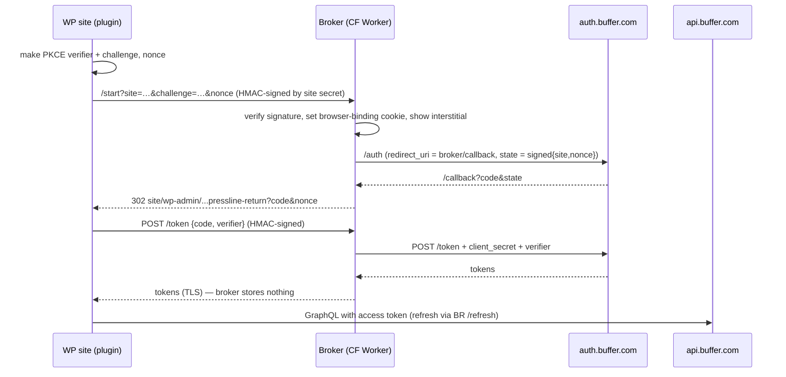

# 02 — Pressline

**Turn any Gutenberg post into a network-perfect launch sequence without leaving the editor. Pick a block, make it a post, preview it as each network will show it, and send the whole set to Buffer as one grouped content item.**

Surface: **WordPress plugin** (Gutenberg sidebar + block toolbar), with a tiny OAuth broker on Cloudflare Workers. User: **editorial teams and solo bloggers on WordPress** who promote every article across 3–6 channels. This plays straight to your WP VIP background.

---

## 1. Problem & target user

| Evidence | Source |
|---|---|
| WordPress tools for Buffer **auto-share on publish** (WP to Buffer), **recycle** old posts (Evergreen) or keep an **editorial calendar** (Nelio). None of them builds per-network posts *from the article's own blocks*, with accurate limits, as a grouped campaign | [WP](https://buffer.com/integrations/wordpress), [Evergreen](https://buffer.com/integrations/evergreen-content-poster), [Nelio](https://buffer.com/integrations/nelio-content) |
| Per-network limits and rules are the hard part: UTF-16 counting, LinkedIn URLs = 24, Instagram line breaks = 2, YouTube bans `<` and `>` | [character limits](https://developers.buffer.com/guides/character-limits.html), [Hiding Elephant](https://buffer.com/resources/hiding-elephant-case-study) |
| Content Items exist so that "Five channels means five calls. Nothing ties those posts together" stops being true | [content items](https://developers.buffer.com/guides/content-items.html) |
| "Some hosts, such as WordPress sites… may block automated requests" for media. WP users hit this silently | [hosting media](https://developers.buffer.com/guides/hosting-media.html) |

**Differentiation from WP to Buffer and Nelio:** those plugins push *one message on publish*. Pressline is a **composer**: block-sourced variants, a campaign over time, media reachability checks, and grouping through Content Items.

## 2. Why it wins

| Criterion | Angle |
|---|---|
| Usefulness | WordPress powers a large share of the web. Every article becomes 4–12 well-formed posts in about 2 minutes |
| Craft | WP-VIP-grade plugin: PHPCS VIP standard, capability checks, nonces, `sodium` encryption, `@wordpress/data` store, i18n. A proper OAuth broker for a distributable plugin |
| Creativity | Gutenberg **blocks become posts**. A pull quote becomes a Threads post, an image block becomes an Instagram post, a list block becomes an X thread |
| **Delight** | Block toolbar **"✦ Make a post"**: the block flies into a channel card with a small animation. Live, network-faithful previews with a ring counter that turns amber or red at the true limit. A **launch timeline** (Day 0 / 2 / 7 / 30) you drag posts along |

## 3. MVP vs stretch

| MVP | Stretch |
|---|---|
| Settings → "Connect Buffer" (via broker), pick org and channels | Buffer Notes: "Request review" on the content item, with comments shown in the sidebar |
| Sidebar: one variant per selected channel, auto-drafted from title, excerpt and featured image | AI variant writer (Claude) per network |
| Block toolbar "Make a post" for paragraph, quote, pullquote, image and list blocks. A list becomes a thread where the network supports threads | WooCommerce product sidebar (careful: overlaps [Pokémon](https://buffer.com/resources/pokemon-cards)) |
| Accurate counters for each network's rules, plus YouTube `<`/`>` guard | WordPress Playground "try it" (see Risks) |
| Media reachability probe (HEAD/GET from the server and flag WAF/bot blocks) | Multisite network activation |
| Send as **Content Item** (draft or queue), with an optional 4-step launch sequence (one content item per step) | |
| Post meta stores content item IDs; status panel shows each variant's state | |

## 4. User flow

```mermaid
flowchart LR
  A[WP Admin → Pressline → Connect] --> B[Broker interstitial<br/>'Connect example.com?']
  B --> C[Buffer consent<br/>OAuth+PKCE]
  C --> D[Back in WP: pick org + channels]
  D --> E[Edit post in Gutenberg]
  E --> F[Block toolbar: Make a post]
  F --> G[Sidebar: per-network preview + counters]
  G --> H[Launch timeline D0/D2/D7/D30]
  H --> I[Send → createContentItem per step]
  I --> J[Status panel: drafted / scheduled ✓]
```

## 5. Buffer API usage

| Operation | Scope | Why |
|---|---|---|
| `account { organizations { id name } }` | account:read | Org picker (cached in an option) |
| `channels(input:{organizationId})` → `id name service avatar timezone metadata{… on MastodonMetadata{maxCharacters}}` | account:read | Channel cards, limits, timezone for the timeline |
| `createContentItem(input:{organizationId, title, targetDate, tagIds, posts:[{channelId,text,assets,metadata,schedulingType:automatic,mode,dueAt,saveToDraft}]})` ⚠️ exp. | posts:write | One call per launch step. All-or-nothing validation |
| Fallback: `createPost` per channel | posts:write | If Content Items misbehave |
| `contentItem(input:{id}) { body{… on PostContent{posts{id status dueAt channel{id}}}} }` ⚠️ exp. | posts:read | Status panel, with one call per step |
| `tagsV2` / `createTag` ⚠️ exp. | posts:read/write | Tag campaigns by WP category |
| Thread metadata (X, Threads, Bluesky, Mastodon) via `metadata.*.thread` | posts:write | List block → thread ([example](https://developers.buffer.com/examples/create-threaded-post.html)) |

**Scopes:** `account:read posts:read posts:write offline_access`.

**Rate limits:** about 2 cached reads per editor session plus 1–4 writes per article. Status refresh happens only when the panel is opened, with a 5-min cache. Every site shares one client quota, so the broker records per-site counts and soft-caps at 40 calls/day per site during judging.

**Assumption to test on Day 1:** the exact thread metadata shape inside `createContentItem.posts[]`, and whether WordPress media URLs from the demo host can be fetched by Buffer.

## 6. Tech stack

| Layer | Choice | Why |
|---|---|---|
| Plugin backend | PHP 8.1+, WP REST API (`/wp-json/pressline/v1`), `wp_remote_post` | Your core skill. Native caching and HTTP API |
| Editor UI | React via `@wordpress/scripts`, `@wordpress/plugins` (PluginSidebar), `@wordpress/data` store, `@wordpress/block-editor` BlockControls | Native Gutenberg look, so it feels built in |
| Counting | Shared TS module (UTF-16 + per-network rules), mirrored in PHP for server validation | Same results on the client and the server |
| Token storage | `wp_options` (autoload=no), encrypted with `sodium_crypto_secretbox`. Key from a `PRESSLINE_KEY` constant in `wp-config.php`, falling back to a key derived from `wp_salt('secure_auth')` | Industry-standard authenticated encryption, with no plaintext tokens in the DB |
| OAuth broker | Cloudflare Worker (TypeScript) + Workers KV (site registry, per-site counters) | Holds the client secret and one fixed redirect URI. Free tier |
| Demo hosting | WordPress on a ~€4–6/mo VPS (e.g., Hetzner) with Docker + Caddy, or a host you already use | Judges need a live WP admin |
| AI (stretch) | `claude-haiku-5-5` via broker or site key | Only if ahead |
| Monitoring | Sentry PHP + JS, Better Stack uptime on demo and broker | |

## 7. Architecture

**Data model**

| Store | Key | Contents |
|---|---|---|
| `wp_options` `pressline_connection` | — | enc(access, refresh), expires_at, scope, org_id, channel cache (JSON, 30 min) |
| `wp_options` `pressline_site_secret` | — | HMAC key shared with the broker at registration |
| Post meta `_pressline_items` | post_id | `[{step:'d0', content_item_id, sent_at, channels:[…]}]` |
| Post meta `_pressline_draft` | post_id | Unsent variants JSON (autosaved) |
| Broker KV `site:<hash>` | site URL hash | site secret hash, registered_at, daily call count |

## 8. Security

- PKCE is generated **on the WP site**. The verifier never leaves the site until the token exchange, so a stolen `code` is useless on its own. The broker holds the `client_secret` and never stores tokens.
- Broker `/start` and `/token` calls are HMAC-signed with the per-site secret. The `state` is a signed, short-lived blob. A browser-binding cookie stops code injection. The interstitial shows the destination domain to blunt consent phishing.
- WordPress side:
  - `manage_options` is needed to connect, `edit_post` to send.
  - REST nonces and `permission_callback` on every route.
  - Inputs are sanitized and escaped (VIP standards).
  - Tokens are encrypted with sodium and never sent to JavaScript. The editor calls the WP REST API, and the server calls Buffer.
- Refresh runs under a WP lock (`add_option` mutex with a short TTL) so concurrent editor tabs can't replay a refresh token.

## 9. Day-by-day plan

Times are Bangladesh time. The deadline is **Nov 14, 1:59 PM BST**.

| Day | Date | Goal |
|---|---|---|
| 1 | Thu Nov 5 | `wp-env` scaffold, plugin skeleton, Buffer client, **direct OAuth on the demo site** (fixed redirect URI) so API calls work today. Run the spikes from §5 |
| 2 | Fri Nov 6 | Broker Worker (start/callback/token/refresh) + site registration. Switch the plugin to broker mode |
| 3 | Sat Nov 7 | Sidebar: channel cards, auto-draft, counters (TS + PHP), tests |
| 4 | Sun Nov 8 | Block toolbar "Make a post", list → thread, image → asset + reachability probe |
| 5 | Mon Nov 9 | Launch timeline + `createContentItem` + status panel |
| 6 | Tue Nov 10 | Previews and animation polish, i18n, empty and error states. **Office hours** |
| 7 | Wed Nov 11 | Demo VPS hardening, judge accounts, nightly reset, PHPUnit/Jest/Playwright in CI, Sentry |
| 8 | Thu Nov 12 | **Freeze.** Record the video, write the summary, publish the plugin zip on GitHub Releases |
| Buffer | Fri Nov 13 | Bugs only. **Submit by 10 PM BST** |

## 10. Zero to production

1. Repo: `pressline/` (plugin) and `broker/` (Worker) monorepo. `composer` (PHPCS + VIP rules), `pnpm` (wp-scripts).
2. Buffer client: private. Permissions account:read, posts:read, posts:write. Redirect URIs: `https://localhost:8889/…` (wp-env HTTPS proxy), `https://demo.<domain>/wp-admin/admin.php?page=pressline-callback` (direct mode) and `https://connect.<domain>/callback` (broker).
3. Broker secrets via `wrangler secret put BUFFER_CLIENT_SECRET`, plus `BUFFER_CLIENT_ID`, `STATE_SIGNING_KEY`.
4. Demo site: Docker WordPress + MariaDB + Caddy (auto-HTTPS), `PRESSLINE_KEY` in `wp-config.php`, WP-Cron replaced by system cron, daily DB snapshot and reset at 03:00 UTC, and a fail2ban/Wordfence-style login rate limit.
5. CI (GitHub Actions): PHPCS (WordPress-VIP-Go), PHPUnit on `wp-env`, Jest, Playwright (`@wordpress/e2e-test-utils-playwright`), `wrangler deploy` on `main` for the broker, and rsync of the zip to the demo on tag.
6. Domain: `demo.` and `connect.` subdomains on Cloudflare. Uptime monitors on both. Sentry DSNs for PHP and JS.
7. Uptime through Dec 7: VPS auto-updates for security patches only, a weekly manual check, and a broker health route that doesn't call Buffer.

## 11. Testing plan

| Layer | What | How |
|---|---|---|
| PHP unit | Encryption round trip, counter parity with TS, REST permission callbacks, refresh lock | PHPUnit + `wp-env` |
| JS unit | Block → variant transforms, thread splitting, counters | Jest |
| Broker | Signature checks, state expiry, cookie binding, no token persistence | Vitest + Miniflare |
| E2E | Connect → compose from blocks → send → status shows drafts in Buffer | Playwright on `wp-env` + a real Buffer test org with `saveToDraft` |
| Manual | Media reachability on the demo host, threads on X, Bluesky and Threads | Checklist |

## 12. Submission kit

**Write-up outline:** "WordPress already pushes links to Buffer. I wanted the article itself to become the social campaign" → block-to-post → accuracy → content items and the broker architecture → next steps (Notes review, AI variants, wordpress.org listing).

**Demo script (≤ 2:00)**

| Time | Shot |
|---|---|
| 0:00–0:10 | An article in Gutenberg. "Promoting this properly takes 30 minutes in 6 tabs." |
| 0:10–0:25 | Connect: broker interstitial → Buffer consent → back |
| 0:25–1:05 | Click a pull quote → **Make a post** → it flies to the Threads card. A list block becomes an X thread. The image goes to Instagram. A counter turns red on Bluesky, gets fixed, turns green |
| 1:05–1:25 | Launch timeline: drag the D7 step, Send. Cut to Buffer showing the grouped drafts |
| 1:25–1:45 | Status panel, and the media reachability warning caught on a bot-protected image |
| 1:45–2:00 | Craft: VIP standards, encrypted tokens, broker diagram |

**Build-in-public:** 5 posts via Buffer (#BufferCommit):
1. The idea and why WP auto-share isn't enough
2. Diagram of the broker architecture
3. GIF of block → post
4. The UTF-16 counter story
5. Launch

Target the WordPress community too (Post Status, WP Tavern-adjacent folks on X and Bluesky).

## 13. Risks & mitigations

| Risk | Mitigation |
|---|---|
| Judges must log into a WP admin, so the "publicly available" bar is arguable (ASSUMPTION it's acceptable) | One-click "Open demo as Editor" auto-login link with limited caps, plus the zip download. Ask in Discord/office hours on Day 1 |
| Broker adds attack surface and build time | Keep it about 150 LOC, stateless. Direct mode remains a fallback for the demo |
| Demo host WAF blocks Buffer media fetches | Serve uploads through Cloudflare with bot-fight disabled for `/wp-content/uploads/`. The reachability probe surfaces this |
| Content Items is experimental | `createPost` fallback path behind a flag |
| WordPress Playground can't reach Buffer (CORS from browser-PHP, ASSUMPTION) | Don't promise Playground. It stays a stretch goal |
| Overlap with existing WP plugins | Lead with blocks → posts plus the timeline in every demo frame, never with "auto-share" |
| Scope creep (Woo, AI) | Both stay stretch, untouched until after the Day-8 freeze |
