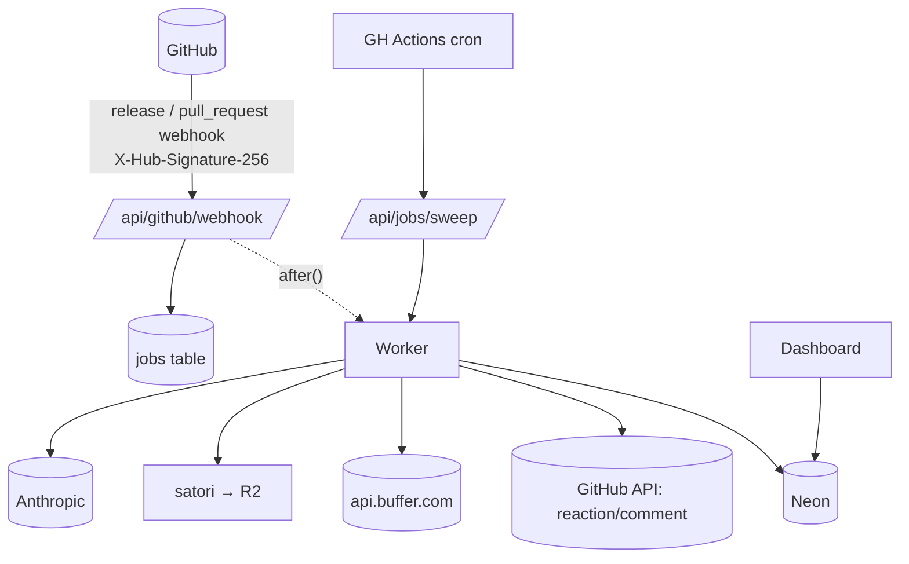

# 03 — Shipnotes

**Every GitHub release, or every merged PR labelled `announce`, becomes reviewed social drafts in Buffer: one per channel, with a generated launch card. CI never gets the keys to publish.**

Surface: **GitHub App** (webhook-driven) + small Next.js dashboard. User: **indie hackers, OSS maintainers, devtool startups and DevRel teams** who ship weekly and forget to tell anyone.

---

## 1. Problem & target user

| Evidence | Source |
|---|---|
| A suggestions-board post asks for exactly this: *"draft a post or create an idea automatically via GitHub workflow when we merge a community-created pull request… we need to be sure that the API key cannot be used to directly publish content."* | [API permissions / scopes](https://suggestions.buffer.com/p/api-permissions-scopes) via the [API roadmap](https://developers.buffer.com/roadmap.html) |
| Personal API keys have "no per-organization scoping" and full account power. Putting one in CI secrets is risky | [auth](https://developers.buffer.com/guides/authentication.html) |
| OAuth app clients can request **only** `ideas:write` or `posts:write`, and posts can be forced to `saveToDraft` | [auth scopes](https://developers.buffer.com/guides/authentication.html), [reference](https://developers.buffer.com/reference.html) |
| Developer demand for Buffer in dev workflows: the [Claude Code skill](https://suggestions.buffer.com/p/can-you-create-a-claude-code-skill) request has 20 votes, and integrations exist for Cursor, Antigravity and the MCP server | [roadmap](https://developers.buffer.com/roadmap.html), [integrations](https://buffer.com/integrations) |
| No existing case study or integration bridges GitHub → Buffer | [research §5](../../research/buffer-commit-research.md#5-what-already-exists-dont-duplicate) |

## 2. Why it wins

| Criterion | Angle |
|---|---|
| Usefulness | Turns shipping into posting automatically, with a human approving in Buffer. Ideal for the "post every day" builder crowd |
| Craft | Signed webhooks, idempotent job queue, least-privilege GitHub *and* Buffer scopes, draft-only guarantee enforced server-side. Appeals to an engineer judge |
| Creativity | GitHub becomes a content source. Release notes become per-network copy. Draft-only safety answers a real board request |
| **Delight** | An auto-generated **launch card** (repo name, version, top 3 changes, language-coloured gradient). Shipnotes **reacts 🚀 on the release** and comments on the PR with a preview of the drafts. A "shipping streak" on the dashboard |
| Build-in-public | **Dogfooded:** Shipnotes drafts your own #BufferCommit updates from this repo's releases |

## 3. MVP vs stretch

| MVP | Stretch |
|---|---|
| Install the GitHub App on repos and connect Buffer | Slack or email "drafts ready" ping |
| Per-repo config: org, channels, mode (**Idea** or **Draft posts**), tone, triggers (release published, or PR merged with label) | Changelog-file trigger (CHANGELOG.md diff) |
| Claude turns release notes / PR body into per-network variants that respect the limits (X thread if long) | Monthly "what we shipped" roll-up idea |
| Launch card PNG (satori) stored on R2 at a stable public URL | Multiple card templates and a brand colour picker |
| Create a Buffer **content item with draft posts** (`saveToDraft:true`), or a **createIdea** | Ideas-board group per repo (`ideaGroups`) |
| Release 🚀 reaction, PR comment with the draft summary | GitHub Action variant for GHES |
| Dashboard: recent ships, status, retry | |

## 4. User flow

```mermaid
flowchart LR
  A[shipnotes.dev → Install GitHub App] --> B[Pick repos]
  B --> C[Connect Buffer<br/>OAuth+PKCE]
  C --> D[Map repo → channels + mode]
  D --> E[Publish GitHub release]
  E --> F[Webhook → job]
  F --> G[AI variants + launch card]
  G --> H[createContentItem<br/>saveToDraft:true]
  H --> I[🚀 on release / PR comment]
  I --> J[Review & schedule in Buffer]
```

## 5. Buffer API usage

| Operation | Scope | Why |
|---|---|---|
| `account { id organizations { id name } }` | account:read | Org mapping |
| `channels(input:{organizationId})` → `id name service avatar` + Mastodon `maxCharacters` | account:read | Channel picker, per-network limits |
| `createContentItem(input:{organizationId, title:"v1.4.0", targetDate, posts:[{channelId, text, assets:[{image:{url, metadata:{altText}}}], metadata:{twitter:{thread…}}, schedulingType:automatic, mode:addToQueue, saveToDraft:true}]})` ⚠️ exp. | posts:write | One call creates every channel's draft, grouped, with all-or-nothing validation |
| Fallback: `createPost` × channels, `saveToDraft:true` | posts:write | If Content Items fail |
| `createIdea(input:{organizationId, content:{title, text, media?, services}})` | ideas:write | "Idea mode": the safest option, since nothing is attached to a channel |

**Scopes:** `account:read posts:write ideas:write offline_access`. No `posts:read`, so the app can't even read the queue.

**Draft-only guarantee:** the server hard-codes `saveToDraft:true`. No code path sends `shareNow` or `customScheduled`. A unit test asserts this, and the README states it.

**Rate limits:** about 1 Buffer call per ship, plus cached reads. With the handbook's 250/day, that's effectively unlimited for the contest. Even so, the job worker honours `Retry-After` and reschedules the job (no tight loop).

**Assumptions to test on Day 1:**
- Thread metadata inside `createContentItem.posts[]`
- Whether `createIdea` accepts an image URL in `media` (`IdeaMediaInput` fields aren't verified)
- Whether `saveToDraft` is honoured per variant in content items

## 6. Tech stack

| Layer | Choice | Why |
|---|---|---|
| App | Next.js 15 + TS on Vercel | [shared](../SHARED-FOUNDATION.md#4-standard-stack-web-ideas) |
| GitHub | GitHub App via `@octokit/app` + `@octokit/webhooks` | Repo-scoped install tokens, signed webhooks |
| Jobs | Postgres `jobs` table + Next `after()` for inline processing + GitHub Actions cron (every 10 min) hitting `/api/jobs/sweep` for retries | No extra infrastructure. Vercel Hobby cron is too coarse |
| AI | Anthropic `claude-haiku-5-5` (JSON output: `{service, text, thread?[]}`), validated against counters | Cheap and fast. Output checked by deterministic counters |
| Images | `satori` + `@resvg/resvg-js` → PNG → Cloudflare R2 public bucket (`cards.<domain>`) | Stable, permanent URL, as Buffer requires ([hosting media](https://developers.buffer.com/guides/hosting-media.html)) |
| DB | Neon Postgres + Drizzle | Installs, repos, ships, jobs |
| Session / tokens | iron-session + AES-256-GCM | [shared](../SHARED-FOUNDATION.md#2-token-store-postgres-with-a-single-writer-refresh) |

## 7. Architecture

**Data model**

| Table | Columns |
|---|---|
| `installations` | id (GH installation id), account_login, user_id, created_at |
| `repos` | id, installation_id, full_name, org_id, channel_ids text[], mode (idea/draft), tone, triggers jsonb, enabled |
| `ships` | id, repo_id, kind (release/pr), gh_ref (tag or PR #), title, body_hash, card_url, buffer_content_item_id, buffer_idea_id, status, error, created_at |
| `jobs` | id, ship_id, attempt, run_after, locked_until, last_error. **Unique (repo_id, gh_ref)** for idempotency, since GitHub redelivers webhooks |

## 8. Security

- Verify the GitHub webhook HMAC (`X-Hub-Signature-256`) with a timing-safe compare, and reject anything that doesn't match.
- GitHub App permissions: Metadata read, Contents read, Pull requests read and write (comments), and release reactions (ASSUMPTION: confirm the permission name). Nothing else.
- Buffer: minimal scopes, with no `posts:read`. Draft-only is enforced server-side.
- Release notes from outside contributors are **untrusted input** to the LLM. Use a strict output schema, no tool use, and strip URLs that don't point to the repo's domain or GitHub.
- Secrets: GitHub App private key (PEM, base64 in env), webhook secret, Buffer secret, R2 keys. All live in Vercel env, never in the repo.

## 9. Day-by-day plan

Times are Bangladesh time. The deadline is **Nov 14, 1:59 PM BST**.

| Day | Date | Goal |
|---|---|---|
| 1 | Thu Nov 5 | Foundation: Buffer OAuth + tokens + deploy. Spike `createContentItem` with drafts and threads |
| 2 | Fri Nov 6 | GitHub App registration, install flow, signed webhook → jobs table |
| 3 | Sat Nov 7 | Worker: AI variants + counters + content item draft. End to end on a test repo |
| 4 | Sun Nov 8 | Launch card (satori → R2), release reaction, PR comment |
| 5 | Mon Nov 9 | Dashboard: repo config, ships list, retry. Idea mode |
| 6 | Tue Nov 10 | Polish, onboarding copy, card design, empty and error states. **Office hours** |
| 7 | Wed Nov 11 | Tests (webhook signature, idempotency, draft-only), Playwright, Sentry, uptime, privacy |
| 8 | Thu Nov 12 | **Freeze.** Video, summary, cut a real `v1.0.0` release of Shipnotes *with Shipnotes* |
| Buffer | Fri Nov 13 | Bugs only. **Submit by 10 PM BST** |

## 10. Zero to production

Follow [shared §5](../SHARED-FOUNDATION.md#5-zero-to-production-checklist-shared), plus:
- Register the GitHub App:
  - Webhook URL `https://shipnotes.<domain>/api/github/webhook`
  - Events: Release, Pull request
  - Setup URL → `/onboarding`
  - Separate dev app pointing at a smee.io proxy for local work
- Env: `GITHUB_APP_ID`, `GITHUB_APP_PRIVATE_KEY`, `GITHUB_WEBHOOK_SECRET`, `R2_ACCOUNT_ID`, `R2_ACCESS_KEY_ID`, `R2_SECRET_ACCESS_KEY`, `R2_BUCKET`, `CARDS_BASE_URL`, `ANTHROPIC_API_KEY`, `ANTHROPIC_MODEL`, `CRON_SECRET`.
- R2: public bucket on a custom domain `cards.<domain>`, immutable object keys (`<repo>/<tag>-<hash>.png`), no lifecycle deletion until at least Jan 2027.
- `.github/workflows/sweep.yml`: `schedule: '*/10 * * * *'` → `curl -H "Authorization: Bearer $CRON_SECRET" …/api/jobs/sweep`.

## 11. Testing plan

| Layer | What | How |
|---|---|---|
| Unit | Release-notes parser, counters, thread splitter, **draft-only invariant**, card renderer snapshot | Vitest + image snapshot |
| Integration | Webhook signature valid/invalid, redelivery idempotency, job retry on 429 and 5xx | Vitest + `msw` + recorded GitHub payload fixtures |
| E2E | Install → config → publish release on a sandbox repo → drafts appear in Buffer → reaction appears | Playwright + a real sandbox repo and Buffer test org |
| Manual | Thread rendering on X, Bluesky and Mastodon drafts in Buffer's composer | Checklist |

## 12. Submission kit

**Write-up outline:** the board request quote → why CI and personal keys are risky → Shipnotes' draft-only design → GitHub + Buffer flow → card generation and hosting (solves "no media upload") → next steps (changelog files, roll-ups, GitLab).

**Demo script (≤ 2:00)**

| Time | Shot |
|---|---|
| 0:00–0:10 | "I shipped 9 releases this month and announced 1." |
| 0:10–0:30 | Install the GitHub App → Connect Buffer (real consent) → map the repo to LinkedIn, X, Bluesky and Mastodon, mode = Draft |
| 0:30–0:55 | Click *Publish release* on GitHub. Within about 10 s the 🚀 reaction appears on the release |
| 0:55–1:30 | Open Buffer: grouped drafts with a per-network thread on X, the launch card attached, alt text set |
| 1:30–1:45 | PR with label `announce` merged → comment with draft previews |
| 1:45–2:00 | "Nothing can publish without you." Scopes slide-in, URL |

**Build-in-public:** every post is drafted by Shipnotes from this repo's releases, then scheduled through Buffer (#BufferCommit). That trail *is* the demo:
1. v0.1 "hello webhook"
2. v0.3 first draft
3. v0.5 launch cards
4. v0.8 polish
5. v1.0 launch

## 13. Risks & mitigations

| Risk | Mitigation |
|---|---|
| Niche audience lowers the usefulness score | Pitch it as "for anyone who ships". Show an Idea mode that marketers on dev teams can use |
| Content Items experimental, or `saveToDraft` behaves differently per variant | Day-1 spike, with a `createPost` fallback |
| Release reaction API permission (ASSUMPTION) | Fall back to PR comment and a dashboard notification |
| AI produces off-limit copy | Deterministic counter validation, one auto-retry with a "shorten" instruction, then flag for manual edit |
| Webhook bursts (monorepo releases) | Idempotent jobs, per-installation concurrency of 1, `Retry-After` honoured |
| Scope creep (GitLab, changelog diffing) | Stretch only |
