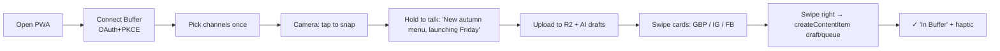
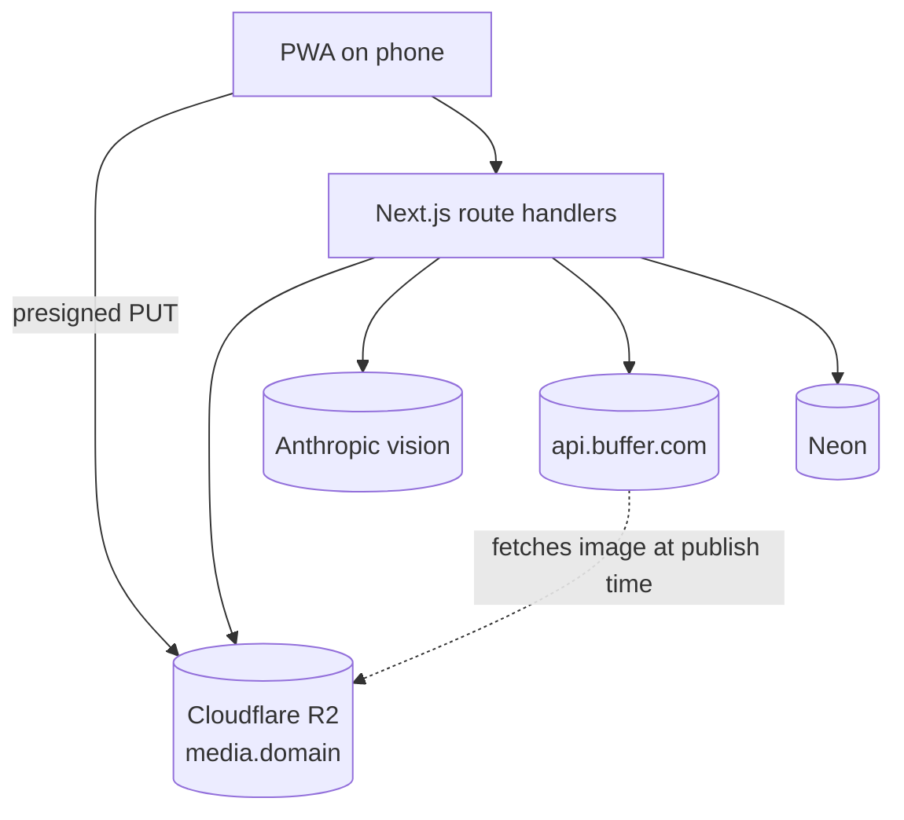

# 04 — Snapline

**Snap, speak, done. A phone-first capture app that turns one photo and ten seconds of voice into Google Business, Instagram and Facebook posts in Buffer, ready to review. It hosts the image for you, so "where do I put my media?" never comes up.**

Surface: **installable mobile PWA** (Next.js). User: **local business owners and field staff**, like cafés, salons, trades, real-estate agents and gyms. They post from the shop floor, not a desk.

---

## 1. Problem & target user

| Evidence | Source |
|---|---|
| Top open API request (24 votes): *"a real blocker that any image to attach through the API must already be hosted online"*. Plus 18 votes for "copy media to Buffer storage" | [Image assets for API](https://suggestions.buffer.com/p/image-assets-for-api), [Copy media](https://suggestions.buffer.com/p/copy-media-to-buffer-storage-after-post-creation) via [API roadmap](https://developers.buffer.com/roadmap.html) |
| The API has **no upload endpoint**. URLs must be public, direct, HTTPS and stable until the post publishes. Pre-signed URLs fail silently | [hosting media](https://developers.buffer.com/guides/hosting-media.html) |
| Google Business Profile is a first-class channel with its own post types (`whats_new`, `offer`, `event`) and CTA buttons | [reference](https://developers.buffer.com/reference.html), [posts](https://developers.buffer.com/guides/posts-and-scheduling.html) |
| Buffer's goal: tools for "the people who post every day" | [commit](https://buffer.com/api/commit) |

**Differentiation:** Hiding Elephant is a *desktop design workspace for creative teams* ([case study](https://buffer.com/resources/hiding-elephant-case-study)). Pokémon Cards is a single-seller listing pipeline ([case study](https://buffer.com/resources/pokemon-cards)). Snapline is a **one-thumb mobile capture loop for non-marketers**, with GBP-native posts and no design step.

## 2. Why it wins

| Criterion | Angle |
|---|---|
| Usefulness | Local SMBs are Buffer's daily posters. Posting turns from a desk task into a 20-second habit |
| Craft | Offline-tolerant PWA, image pipeline (EXIF strip, resize, WebP/JPEG, alt text), stable R2 hosting, GBP metadata done right |
| Creativity | Voice-first composer that understands "20% off cuts until Sunday" → a GBP **offer** with dates and a button |
| **Delight** | A full-screen camera with a **hold-to-talk** button and a waveform. Results arrive as a **stack of swipeable cards** (one per channel): swipe right to send a draft, left to discard. Haptic tick on success (where supported) |

## 3. MVP vs stretch

| MVP | Stretch |
|---|---|
| PWA install, Buffer OAuth, choose channels once | Offline queue (IndexedDB + Background Sync) |
| Camera or library capture, client-side resize + EXIF strip | Video clips (short) |
| Hold-to-talk via Web Speech API (`SpeechRecognition`), with a typing fallback | Server-side transcription fallback for unsupported browsers |
| AI: caption per channel + alt text + GBP type detection (whats_new / offer / event) | Brand voice presets per business |
| Upload to R2 → stable URL → `createContentItem` with `saveToDraft:true` (or queue) | "Weekly photo dump" carousel suggestion |
| Swipe cards UI, edit inline, send | Multi-location GBP picker |
| History of the last 20 snaps | |

## 4. User flow

## 5. Buffer API usage

| Operation | Scope | Why |
|---|---|---|
| `account { id timezone organizations { id name } }` | account:read | Org and timezone |
| `channels(input:{organizationId})` → `id name service avatar timezone isDisconnected` | account:read | One-time channel setup. Warn on disconnected channels |
| `createContentItem(input:{organizationId, title, posts:[…]})` ⚠️ exp. | posts:write | One call per snap. GBP variant uses `metadata.google:{type:offer, title, detailsOffer{…}}` or `whats_new` with a button. IG uses `metadata.instagram{type:post}` |
| Fallback: `createPost` per channel | posts:write | If Content Items fail |
| `dailyPostingLimits(input:{channelIds, date})` | posts:read (ASSUMPTION) | Warn before hitting a network's daily limit |

**Scopes:** `account:read posts:read posts:write offline_access`. Drop `posts:read` if `dailyPostingLimits` turns out not to need it.

**Media:** images are uploaded to Cloudflare R2 (public custom domain `media.<domain>`) under immutable keys and kept for **≥ 90 days**. Before calling Buffer, the server does a HEAD check to confirm the URL is public and reachable ([hosting media](https://developers.buffer.com/guides/hosting-media.html)).

**Rate limits:** about 1 write per snap, with cached reads. Budget meter as in [shared](../SHARED-FOUNDATION.md#3-buffer-graphql-client).

**Assumptions to test on Day 1:**
- The exact `GoogleBusinessPostMetadataInput` shape accepted through `createContentItem`. The docs mark it `@deprecated: pending proposal`, so test it
- Instagram image aspect-ratio rules

## 6. Tech stack

| Layer | Choice | Why |
|---|---|---|
| App | Next.js 15 PWA (`serwist` service worker, web manifest) on Vercel | One codebase, installable, no app-store review |
| Camera | `<input type="file" accept="image/*" capture="environment">` + `getUserMedia` preview | Works on iOS and Android browsers |
| Image | `browser-image-compression` client-side (≤ 2048 px, EXIF stripped) + `sharp` server-side to normalize | Smaller uploads, privacy (strips GPS) |
| Voice | Web Speech API, falling back to typing | Free. Coverage varies by browser (ASSUMPTION: check iOS Safari) |
| Storage | Cloudflare R2 + custom domain, presigned PUT for upload only | Public GETs stay stable. Uploads are short-lived and signed |
| AI | Anthropic `claude-haiku-5-5` vision: captions per network, alt text, GBP type/fields as JSON | One multimodal call per snap |
| DB | Neon + Drizzle | Snaps history, channel prefs |
| Session / tokens | iron-session + AES-256-GCM | [shared](../SHARED-FOUNDATION.md#2-token-store-postgres-with-a-single-writer-refresh) |

## 7. Architecture

**Data model**

| Table | Columns |
|---|---|
| `prefs` | user_id, org_id, channel_ids text[], default_mode (draft/queue), voice_lang |
| `snaps` | id, user_id, r2_key, public_url, width, height, alt_text, transcript, ai_output jsonb, buffer_content_item_id, status, created_at |

## 8. Security

- Shared baseline ([shared §6](../SHARED-FOUNDATION.md#6-shared-security-baseline)).
- Presigned R2 PUT URLs are scoped to one key, last 5 min, allow `image/*` only, and enforce size limits server-side.
- EXIF and GPS are stripped before upload. Location data never leaves the phone.
- Uploads are public by design, because Buffer requires it. The privacy page says so, and "Delete snap" removes the R2 object once the post has published.
- Rate-limit uploads per user (10/hour) to block abuse of the public bucket.

## 9. Day-by-day plan

Times are Bangladesh time. The deadline is **Nov 14, 1:59 PM BST**.

| Day | Date | Goal |
|---|---|---|
| 1 | Thu Nov 5 | Foundation + deploy. Spike: R2 URL → `createContentItem` with GBP + IG drafts |
| 2 | Fri Nov 6 | PWA shell, camera capture, compression, presigned upload |
| 3 | Sat Nov 7 | Voice capture + AI multimodal call + counters |
| 4 | Sun Nov 8 | Swipe-card UI, inline edit, send to Buffer |
| 5 | Mon Nov 9 | GBP offer/event detection, history, daily-limit warning |
| 6 | Tue Nov 10 | Real-device testing (iOS and Android), haptics, motion, a11y. **Office hours** |
| 7 | Wed Nov 11 | E2E, Sentry, uptime, privacy, domain, install prompt |
| 8 | Thu Nov 12 | **Freeze.** Film the demo *in a real shop* on a phone. Write the summary |
| Buffer | Fri Nov 13 | Bugs only. **Submit by 10 PM BST** |

## 10. Zero to production

Follow [shared §5](../SHARED-FOUNDATION.md#5-zero-to-production-checklist-shared), plus:
- R2:
  - Bucket `snapline-media` with a public custom domain and CORS allowing PUT from the app origin
  - Lifecycle: delete after 120 days (well past Dec 7)
  - Disable bot-fight on that hostname so Buffer's fetcher isn't blocked ([hosting media](https://developers.buffer.com/guides/hosting-media.html))
- Env: `R2_*`, `MEDIA_BASE_URL`, `ANTHROPIC_API_KEY`, `ANTHROPIC_MODEL`.
- Local HTTPS is required for camera and mic. `next dev --experimental-https`, then test on a phone over LAN via `mkcert` root CA or a tunnel (cloudflared).
- Lighthouse PWA check in CI (`treosh/lighthouse-ci-action`).

## 11. Testing plan

| Layer | What | How |
|---|---|---|
| Unit | Counters, AI output schema validation, GBP field mapper, filename and key generation | Vitest |
| Integration | Presign → upload → HEAD check. Content item payload per service | Vitest + `msw` + MinIO/R2 test bucket |
| E2E | Connect → upload fixture image → typed transcript → swipe → draft exists | Playwright with mobile emulation (iPhone 14, Pixel 7) |
| Device | Camera, mic and install on real iOS Safari and Android Chrome | Manual checklist |
| Media | Buffer actually fetches the R2 image (draft preview shows it) | Manual on Day 1 and Day 7 |

## 12. Submission kit

**Write-up outline:** the shop-owner story → "no upload endpoint" pain (board quote) → Snapline hides hosting → voice → per-channel cards → GBP-native posts → next steps (offline, video, multi-location).

**Demo script (≤ 2:00):** shot vertically on a phone, screen-recorded with picture-in-picture.

| Time | Shot |
|---|---|
| 0:00–0:10 | Café counter: "She has 20 seconds between customers." |
| 0:10–0:25 | Install the PWA, Connect Buffer (consent), pick GBP, IG and FB |
| 0:25–0:55 | Snap the cake. Hold to talk: "Pumpkin cake is back, 15 percent off until Sunday" |
| 0:55–1:25 | Cards stack: a GBP **offer** with dates and a button, IG with alt text, FB. Edit a word, swipe right ×3 |
| 1:25–1:45 | Cut to Buffer: drafts with the image (hosted on R2) |
| 1:45–2:00 | "No hosting, no laptop, no copy-paste." URL |

**Build-in-public:** 5 posts via Buffer (#BufferCommit), each made *with Snapline itself*:
1. Photo of a sketch
2. First working snap
3. The GBP offer discovery
4. Swipe-cards GIF
5. Launch

## 13. Risks & mitigations

| Risk | Mitigation |
|---|---|
| Web Speech API missing or unreliable on some browsers | Typing fallback is first-class. Stretch: server transcription |
| GBP metadata is deprecated or in flux | Day-1 spike. Fall back to a plain `whats_new` post |
| Public bucket abuse | Per-user upload limits, size and type checks, short-lived presign |
| Judges test on desktop | Responsive desktop layout with drag-and-drop photos |
| Overlap perception with Hiding Elephant | Lead with mobile, voice and GBP. No design canvas at all |
| Real-device bugs eat time | Device testing starts Day 2, not Day 6 |
