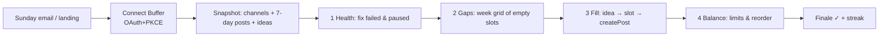
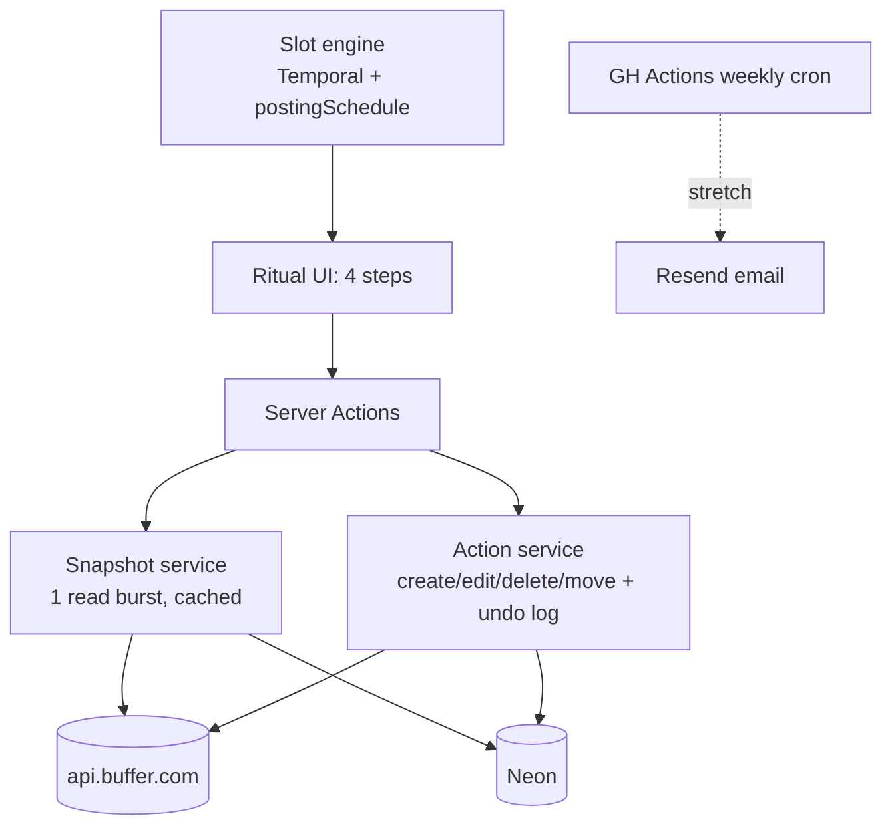

# 05 — Sunday Reset

**A 10-minute weekly ritual for people who post every day. One email every Sunday, then a guided, keyboard-first flow: fix what failed, fill the empty slots from your Ideas, rebalance the week. You finish with every channel's queue full and calm.**

Surface: **weekly email + guided "ritual" web app** (Next.js, a step-by-step flow rather than a dashboard). User: **solo creators, coaches and small-business owners** posting daily to 2–5 channels who let the queue drift.

---

## 1. Problem & target user

| Evidence | Source |
|---|---|
| A queue drifts in ways nobody notices: paused queues (`isQueuePaused`), disconnected channels (`isDisconnected`), failed posts (`status: error`, with `error.message` + `supportUrl`), empty slots in the posting schedule | [reference: Channel, Post, PostStatus](https://developers.buffer.com/reference.html) |
| Ideas are "your content backlog", and the [Query Ideas](https://suggestions.buffer.com/p/query-ideas) request (11 votes) wants Ideas as the seed for drafting posts | [ideas guide](https://developers.buffer.com/guides/ideas.html), [API roadmap](https://developers.buffer.com/roadmap.html) |
| Posting limits are separate from API limits and readable via `dailyPostingLimits` | [rate limits FAQ](https://developers.buffer.com/guides/api-limits.html) |
| PostIQ's content calendar *shows* scheduled posts ([case study](https://buffer.com/resources/postiq-case-study)). Sunday Reset is a *guided maintenance routine* with fixes, not a calendar | — |

## 2. Why it wins

| Criterion | Angle |
|---|---|
| Usefulness | Directly serves the "post every day" crowd. Turns queue anxiety into a weekly habit with a clear end state |
| Craft | Slot math across channel timezones, safe batch actions, rate-limit-aware single "snapshot" read, undo |
| Creativity | A *ritual* rather than a dashboard: the product's shape is the idea. Emotional design for a utility task |
| **Delight** | A calm, typographic flow (one step per screen, `J`/`K`/`Enter`). An **"empty slot" week grid that fills like a tide** as you assign ideas. A finale screen ("Your week is set ✓, 18 posts, 4 channels"), with confetti held to one tasteful burst, and a streak |

## 3. MVP vs stretch

| MVP | Stretch |
|---|---|
| Buffer OAuth, pick org | Sunday email (Resend) with "Start your reset" magic link and a counts summary |
| **Step 1 Health:** paused queues, disconnected channels, posts in `error` with message + help link → Retry (re-queue) or Delete | Snooze channels for holidays |
| **Step 2 Gaps:** next 7 days of `postingSchedule` slots vs `scheduled` posts, per channel, in the channel's timezone | "Evergreen" suggestions from past sent posts |
| **Step 3 Fill:** drag Ideas (or type quick text) into empty slots → `createPost` with `customScheduled` + `dueAt`, or draft | AI "turn this idea into a LinkedIn and X variant" |
| **Step 4 Balance:** flag back-to-back days and over-limit days (`dailyPostingLimits`), move a post to the top or bottom (`movePostInQueue`) | Team mode (multiple members) |
| Finale + streak + undo for the last action | |

## 4. User flow

## 5. Buffer API usage

| Operation | Scope | Why |
|---|---|---|
| `account { timezone organizations { id name } }` | account:read | Org, default timezone |
| `channels(input:{organizationId})` → `id name service avatar timezone isQueuePaused isDisconnected postingSchedule{day times paused}` | account:read | Health + slot math |
| `posts(first:100, input:{organizationId, filter:{status:[scheduled,error], dueAt:{start:now, end:+7d}}})` → `id channelId text dueAt status error{message supportUrl}` | posts:read | One snapshot read (1–2 pages) |
| `ideas(first:50, input:{organizationId})` → `id content{title text services date}` | ideas:read | The backlog to fill from |
| `createPost(input:{channelId, text, schedulingType:automatic, mode:customScheduled, dueAt, ideaId})` | posts:write | Fill a slot, linked back to the idea via `ideaId` |
| `editPost(input:{id, mode:addToQueue})` | posts:write | "Retry" a failed post by re-queuing it (ASSUMPTION: verify an `error` post can be re-queued this way) |
| `deletePost(input:{id})` | posts:write | Discard failed or unwanted posts, and undo for a just-created post |
| `movePostInQueue(input:{id, position:top/bottom})` ⚠️ exp. | posts:write | Rebalance |
| `dailyPostingLimits(input:{channelIds, date})` | posts:read (ASSUMPTION) | Over-limit warnings per day |

**Scopes:** `account:read posts:read posts:write ideas:read offline_access`.

**Rate limits:** a single **snapshot** of about 4 reads per session (channels, posts ×1–2, ideas) is cached for the whole ritual. Then 1 write per action. A typical reset takes about 4 reads + 10 writes ≈ 15 calls. At 250/day, that supports ~15 full resets/day across all users. The email stretch doesn't call Buffer: it uses the last snapshot's counts. During judging, the "Start" button shows remaining budget if it gets low.

**Assumptions to test on Day 1:**
- Whether `postingSchedule.times` are in the channel `timezone` (`HH:MM`). Verify against Buffer's UI
- Whether `mode:customScheduled` into a slot time collides with queue slots

## 6. Tech stack

| Layer | Choice | Why |
|---|---|---|
| App | Next.js 15 + TS on Vercel | [shared](../SHARED-FOUNDATION.md#4-standard-stack-web-ideas) |
| Time math | `Temporal` polyfill (`@js-temporal/polyfill`) | Correct timezone and DST slot calculations (DST just changed in the US and EU) |
| Drag and drop | `dnd-kit` (keyboard sensor) | Accessible drag-and-drop for the Fill step |
| Motion | Framer Motion (`prefers-reduced-motion` respected) | Tide-fill grid, finale |
| Email (stretch) | Resend + React Email | Free tier, nice templates |
| DB | Neon + Drizzle | Snapshots, actions log (undo), streaks |
| Session / tokens | iron-session + AES-256-GCM | [shared](../SHARED-FOUNDATION.md#2-token-store-postgres-with-a-single-writer-refresh) |
| AI | None in MVP (stretch: `claude-haiku-5-5` for idea → variant) | Keeps scope and cost down |

## 7. Architecture

**Data model**

| Table | Columns |
|---|---|
| `snapshots` | id, user_id, org_id, taken_at, channels jsonb, posts jsonb, ideas jsonb (expires 24 h) |
| `actions` | id, user_id, snapshot_id, kind (create/edit/delete/move), post_id, before jsonb, after jsonb, undone_at |
| `streaks` | user_id, last_reset_week (ISO week), count |

## 8. Security

- Shared baseline ([shared §6](../SHARED-FOUNDATION.md#6-shared-security-baseline)).
- Destructive actions (delete) need an explicit confirm. Undo is logged.
- Before every write, re-check the post's `status` and `dueAt` (one cheap `post` read) so the app never clobbers changes made in Buffer meanwhile. Skip this read if the remaining budget is low and warn instead.
- Magic-link email (stretch): a single-use signed token (15 min) that only starts OAuth/session. It never carries Buffer tokens.

## 9. Day-by-day plan

Times are Bangladesh time. The deadline is **Nov 14, 1:59 PM BST**.

| Day | Date | Goal |
|---|---|---|
| 1 | Thu Nov 5 | Foundation + deploy. Spike snapshot queries, slot timezone check |
| 2 | Fri Nov 6 | Slot engine (Temporal) + unit tests incl. DST |
| 3 | Sat Nov 7 | Step 1 Health + Step 2 Gaps grid |
| 4 | Sun Nov 8 | Step 3 Fill (dnd-kit, ideas → createPost, undo) |
| 5 | Mon Nov 9 | Step 4 Balance (limits, move) + Finale + streak |
| 6 | Tue Nov 10 | Typography, motion, keyboard shortcuts, reduced motion, a11y. **Office hours** |
| 7 | Wed Nov 11 | E2E, Sentry, uptime, privacy, domain. Optional email if green |
| 8 | Thu Nov 12 | **Freeze.** Seed a messy demo account, record, write the summary |
| Buffer | Fri Nov 13 | Bugs only. **Submit by 10 PM BST** |

## 10. Zero to production

Follow [shared §5](../SHARED-FOUNDATION.md#5-zero-to-production-checklist-shared), plus:
- Buffer client permissions: account:read, posts:read, posts:write, ideas:read.
- Seed script (`pnpm seed:demo`) that uses *your* OAuth session to create a deliberately messy week in a test org: gaps, a paused channel, an `error`-prone YouTube post with `<`. Re-run it before recording.
- Optional `RESEND_API_KEY`, `EMAIL_FROM`, plus a `weekly-email.yml` cron (Sundays 03:00 UTC = 09:00 BST).

## 11. Testing plan

| Layer | What | How |
|---|---|---|
| Unit | Slot engine: timezones, DST weeks, paused days, slots already taken, past slots | Vitest with table-driven cases |
| Integration | Snapshot assembly + pagination, action + undo, 429 path | Vitest + `msw` |
| E2E | Full ritual on the seeded account → finale shows 0 gaps | Playwright |
| A11y | Keyboard-only ritual, dnd-kit keyboard drag, axe | `@axe-core/playwright` |
| Manual | Created posts land in the correct slot in Buffer's calendar per channel timezone | Checklist |

## 12. Submission kit

**Write-up outline:** "posting daily isn't hard, *maintaining* the queue is" → the 4-step ritual → API usage (posts, ideas, schedules, limits) → why a ritual instead of a dashboard → next steps (email, AI variants, team mode).

**Demo script (≤ 2:00)**

| Time | Shot |
|---|---|
| 0:00–0:10 | A messy week: "3 empty days, 1 paused channel, 2 failed posts. Sound familiar?" |
| 0:10–0:22 | Connect Buffer (consent) → snapshot loads |
| 0:22–0:45 | Health: the failed YouTube post shows Buffer's real error message → fix the text → retry. Unpause hint |
| 0:45–1:20 | Gaps: week grid, then drag 5 ideas into slots with the keyboard. The grid tide-fills. Cut to Buffer's calendar showing them |
| 1:20–1:40 | Balance: over-limit warning on X, move a post down |
| 1:40–2:00 | Finale ✓, streak 1, "See you next Sunday." URL |

**Build-in-public:** 5 posts via Buffer (#BufferCommit):
1. "My queue is a mess, so I'm building a ritual"
2. The slot-engine DST bug
3. Grid-fill GIF
4. Keyboard-only demo
5. Launch

Schedule them during your own Sunday Reset.

## 13. Risks & mitigations

| Risk | Mitigation |
|---|---|
| Perceived overlap with Buffer's own calendar or queue UI | Frame it as *maintenance + backlog*, not viewing. Show fixes and idea-filling, which Buffer doesn't guide |
| Slot semantics (timezone, queue vs custom times) are wrong | Day-1 spike against Buffer's UI. Unit tests. Fall back to `addToQueue` |
| Retrying `error` posts isn't supported via `editPost` | Fall back to delete + recreate (with confirm), or deep-link to Buffer |
| `movePostInQueue` is experimental | Hide the Balance reorder behind a flag. Keep the limit warnings |
| Ideas API returns rich media or tags poorly | Text-only ideas in MVP |
| Scope creep (email, AI) | Both stretch, only after the freeze checklist |
